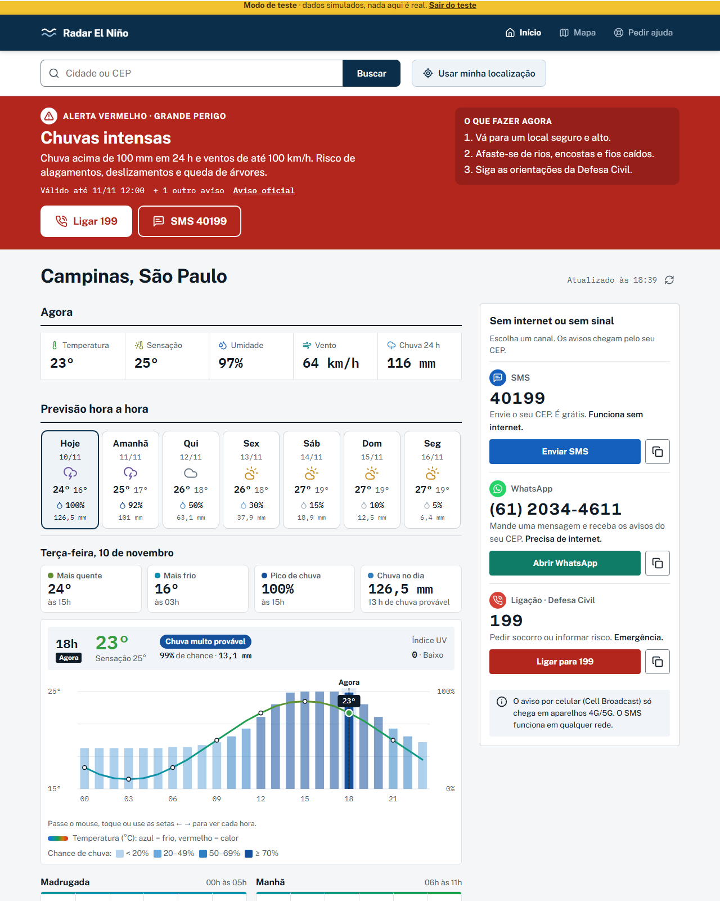
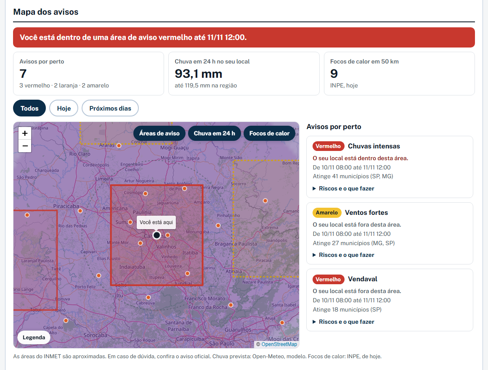
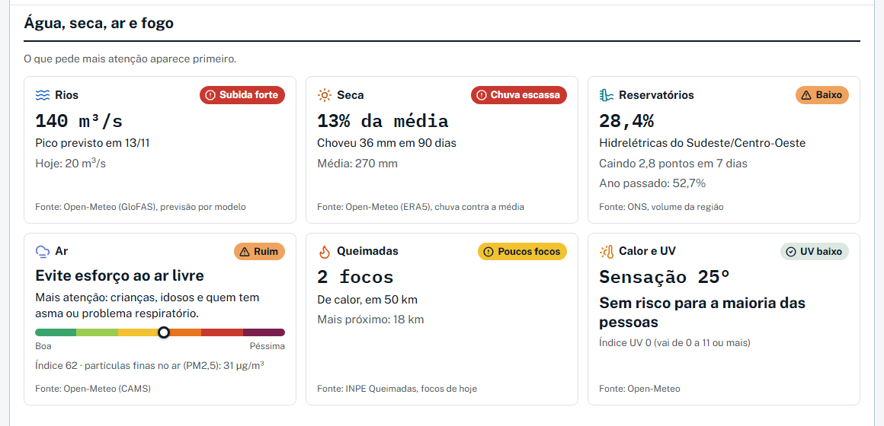

# Radar El Niño

Previsão hora a hora, avisos oficiais e orientações de ajuda para a sua cidade durante o El Niño, tudo em uma tela só.

**[Acessar o site → radar-el-nino.vercel.app](https://radar-el-nino.vercel.app)**

O El Niño muda o clima do Brasil: seca no Norte e Nordeste, chuva forte no Sul, calor extremo, queimadas. As informações existem, mas estão espalhadas em vários portais. O Radar reúne as que importam para quem está na rua ou em casa, em linguagem comum, e funciona bem no celular, até com internet ruim.

> Projeto independente, sem vínculo com órgãos oficiais. **Não substitui os avisos da Defesa Civil, do INMET ou de outros órgãos.**



<sub>Capturas da tela de teste `/teste/extremo`, com dados simulados (nada ali é real).</sub>

<table>
  <tr>
    <td width="50%"></td>
    <td width="50%"></td>
  </tr>
  <tr>
    <td align="center"><sub>Mapa dos avisos</sub></td>
    <td align="center"><sub>Água, seca, ar e fogo</sub></td>
  </tr>
</table>

## O que faz

- **Busca por cidade ou CEP**, com sugestões ao digitar, ou pela localização do aparelho.
- **Agora**: temperatura, sensação térmica, umidade, vento e chuva das últimas 24 h.
- **Previsão hora a hora** com gráfico interativo, resumo do dia e quadros por período. Cada dia da semana é um cartão com ícone do tempo, máxima e mínima, chance e volume de chuva; no celular, a faixa dos dias rola para o lado.
- **Avisos do INMET** (amarelo, laranja e vermelho). O nível vermelho ativa o **modo de emergência**: telefones 199 e SMS 40199 em destaque, orientações e uma barra fixa para ligar no celular.
- **Água, seca, ar e fogo**, em cartões ordenados do mais grave ao menos grave:
  - rios: previsão de vazão (Open-Meteo/GloFAS);
  - reservatórios: volume das hidrelétricas da região (ONS);
  - seca: chuva dos últimos 90 dias contra a média de 9 anos (Open-Meteo/ERA5);
  - queimadas: focos de calor do INPE num raio de 50 km;
  - calor, UV e qualidade do ar explicados sem jargão.
- **Mapa dos avisos** (Leaflet): áreas de aviso do INMET por nível, chuva prevista nas próximas 24 h, o seu local e os focos de calor. Diz se você está dentro de uma área de aviso e lista o que fazer em cada uma.
- **Atualização automática** a cada 5 minutos, ao voltar para a aba e quando a internet volta, com aviso quando surge um alerta novo.
- **PWA e modo offline**: instala no celular e abre sem internet mostrando a última previsão e o último aviso salvos, sempre com a data.
- **Como pedir ajuda**: números de emergência (199, 193, 192, 190) e orientações (abrigo, FGTS, Garantia-Safra, Proagro, carro-pipa, saúde depois da enchente).
- **Doação por Pix** (`/apoie`), com QR Code gerado no próprio navegador.

## Fontes de dados

| Dado | Fonte |
| --- | --- |
| Previsão, vazão de rios, qualidade do ar, chuva histórica | [Open-Meteo](https://open-meteo.com) (inclui GloFAS e ERA5) |
| Avisos meteorológicos | [INMET](https://portal.inmet.gov.br) |
| Focos de calor | [INPE](https://terrabrasilis.dpi.inpe.br/queimadas/) |
| Volume de reservatórios | [ONS](https://www.ons.org.br) |
| Cidade a partir de coordenadas | BigDataCloud |
| Fundo do mapa | OpenStreetMap |

Limites a ter em mente: a vazão dos rios e a qualidade do ar são **modeladas**, não medições de estação; o indicador de seca **não** é o Monitor de Secas oficial; o volume dos reservatórios é da região, não da sua cidade.

## Tecnologias

React 18, Vite 5, Leaflet, vite-plugin-pwa, funções serverless na Vercel e testes com o runner nativo do Node (`node --test`). Não usa banco de dados.

## Rodando localmente

Requer Node.js 18 ou mais recente.

```bash
npm install
npm run dev       # http://localhost:5173
npm test          # testes das funções puras
npm run build     # gera a pasta dist/
npm run preview   # versão publicada, com modo offline
```

### Telas de teste

Abrem a página com dados simulados (nada é real):

- `/teste` ou `/teste/vermelho`: aviso vermelho, modo de emergência
- `/teste/laranja` e `/teste/amarelo`: os outros níveis
- `/teste/extremo`: cenário extremo, com mapa aberto, vários avisos, chuva forte e muitos focos de calor

## Configuração (opcional)

Copie `.env.example` para `.env.local`. Em produção, defina as mesmas variáveis no painel da hospedagem.

| Variável | Para que serve |
| --- | --- |
| `VITE_PIX_KEY`, `VITE_PIX_NAME`, `VITE_PIX_CITY` | Ativam a tela de doação. Sem as três, ela mostra "Doações em breve". A chave nunca fica no código. |
| `VITE_DONATION_PURPOSE` | Texto de "Para que serve" na doação. |
| `VITE_MAP_TILES_URL`, `VITE_MAP_ATTRIBUTION` | Troca o fundo do mapa. O padrão é o OpenStreetMap, cujo servidor gratuito tem regras de uso leve. |

## Publicação

O projeto roda na Vercel sem configuração extra: a pasta `api/` vira funções serverless e o `vercel.json` redireciona todos os endereços (menos `/api/...`) para o app.

Em hospedagem só estática (GitHub Pages, por exemplo) as rotas `/api` não existem: a faixa de aviso mostra o link do portal do INMET e os cartões de queimadas, reservatórios e mapa mostram "Sem dado agora".

## Estrutura

```
api/             funções serverless (alertas, queimadas, reservatórios, mapa)
server/          lógica dos dados (avisos, focos do INPE, reservatórios do ONS, áreas do mapa)
src/lib/         busca, previsão, gráfico, níveis, rotas, Pix, armazenamento
src/components/  telas
public/          ícones do app instalado
tests/           testes (node --test)
```

## Privacidade

O app não tem conta, banco de dados nem rastreadores. A cidade escolhida e a última previsão ficam só no `localStorage` do seu navegador. Para funcionar, as coordenadas da cidade (arredondadas) são enviadas à Open-Meteo e ao nosso servidor, que consulta INMET, INPE e ONS. Se você usar "Usar minha localização", o ponto vai arredondado a cerca de 1 km à BigDataCloud, só para descobrir o nome da cidade.

## Limitações conhecidas

- O endpoint de avisos do INMET (`apiprevmet3.inmet.gov.br/avisos/ativos`) não tem documentação pública. Quando o aviso não traz o nível de severidade em `severidade`, `nivel` ou `cor`, o app mostra "Aviso do INMET" em cinza e aponta para o portal oficial. A normalização está em `server/alerts.js`.
- Ainda não há notificação push com o app fechado, guia de carro-pipa por município, chuva em tempo real (radar) nem mapa de abrigos, por falta de fonte aberta e confiável.
- A API gratuita da Open-Meteo é para uso não comercial. Em caso de patrocínio ou cobrança, confira os termos e o plano comercial, além das regras de INMET, INPE e ONS.
- Os textos de ajuda (FGTS, Proagro, saúde) são gerais, sem valores nem prazos, e merecem revisão de quem é da área.

## Licença

[MIT](LICENSE)
